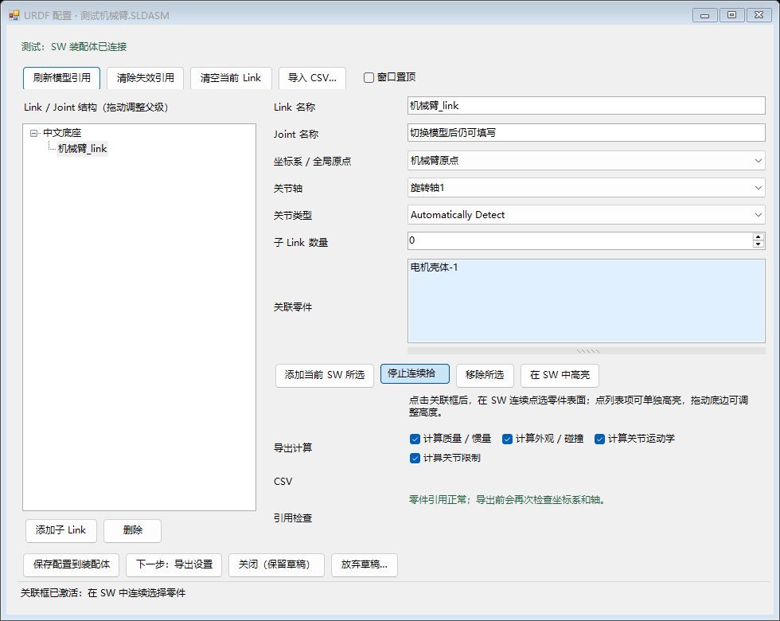

# SolidWorks 2025 URDF 导出插件

在 SolidWorks 2025 中把装配体配置成 URDF 的 Link 和 Joint，并导出 URDF 与 STL 网格。独立窗口可在操作模型时保持打开，配置草稿按装配体保存。

- 在 SW 视窗连续点选零件，关联并高亮对应组件。模型更新后可批量清理失效引用。
- 导出前检查关节名称和父子关系。关节运动学计算关闭时，检查当前坐标系与保存的关节位姿是否相符。
- 计算质量和惯量时读取 SW 当前配置下生效的质量、质心和惯量，包括零件或完整子装配体的覆盖值。

适用于 Windows 64 位和 SolidWorks 2025。安装包、源码压缩包和 SHA-256 校验值见 [v1.7.11 下载页](https://github.com/zzlkr/solidworks-urdf-exporter-sw2025/releases/tag/v1.7.11)。

## 安装与使用

1. 关闭 SolidWorks，运行下载页的 `sw2urdfSetup_SW2025_independent_autosave_v1.7.11.exe`。
2. 重新启动 SolidWorks，打开已保存的装配体，选择「工具 → Export as URDF」。
3. 配置 Link、关节和坐标系，关联零件。点击「下一步：导出设置」，核对详细参数后导出。

要导出整个子装配体的覆盖质量属性，在装配体树中选中子装配体本身，关联到同一个 Link，并勾选「计算质量 / 惯量」。如果只关联内部零件，插件读取各零件自身的质量属性。整组覆盖值无法自动分摊给多个 Link。[使用说明](docs/使用说明_v1.7.11.md)

## 上游项目与致谢

本项目基于 ROS 社区维护的 **SolidWorks to URDF Exporter**。上游提供 Link/Joint 配置、URDF 写入和 STL 导出。本项目在此基础上加入独立配置窗口、草稿恢复、拾取与导出检查，并通过 SolidWorks 的组件质量属性接口读取覆盖值。[上游源码](https://github.com/ros/solidworks_urdf_exporter) · [组件质量属性接口](https://help.solidworks.com/2025/english/api/sldworksapi/SolidWorks.Interop.sldworks~SolidWorks.Interop.sldworks.IMassProperty2_members.html?id=2.2.1.211.0)

感谢原作者 Stephen Brawner、ROS 社区贡献者，以及上游 README 中列出的 PickNik Consulting、Verb Surgical、Open Robotics 和 Willow Garage。[上游项目说明](https://github.com/ros/solidworks_urdf_exporter#readme)

## 许可证

本仓库的插件源码沿用上游 **MIT** 许可证。第三方组件适用各自的许可证。[许可证全文](LICENSE)

| 主要组件 | 用途 | 许可证 |
| --- | --- | --- |
| CsvHelper | CSV 导入与导出 | [MS-PL 或 Apache 2.0](https://github.com/JoshClose/CsvHelper/blob/7.1.1/LICENSE.txt) |
| Math.NET Numerics | 矩阵和坐标变换 | [MIT](https://numerics.mathdotnet.com/License) |
| Apache log4net | 导出与故障日志 | [Apache 2.0](https://github.com/apache/logging-log4net/blob/master/LICENSE) |

## 从源码构建与验证

使用 Visual Studio 2022 MSBuild、.NET Framework 4.8 开发工具和 SolidWorks 2025 API。先运行 `nuget restore SW2URDF.sln`，再用 `Build-Independent.ps1` 构建。安装包构建另需 Inno Setup。[构建命令与检查方法](INDEPENDENT-WINDOW.md#build-on-windows) · [NuGet 依赖版本](SW2URDF/packages.config)

v1.7.11 已通过构建和 99 项隔离检查。测试使用模拟装配体工作区，真实 SolidWorks 中的整组覆盖值读取与完整导出仍待实机验证。[版本记录](VERSION_HISTORY.md)
